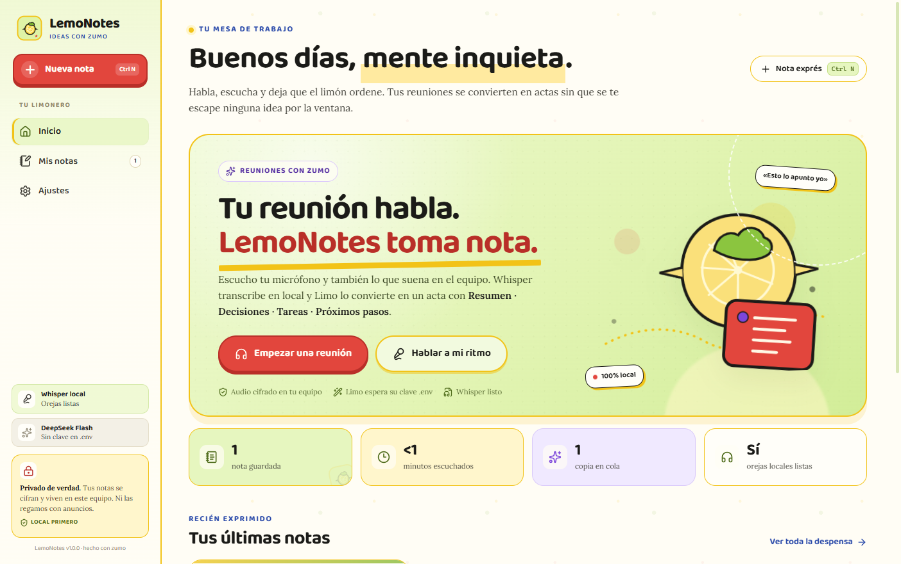
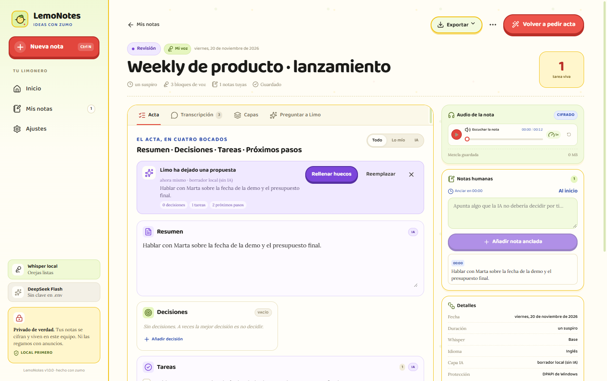

# LemoNotes

**Tus reuniones hablan. LemoNotes toma nota.**

LemoNotes es una aplicación de escritorio para Windows que graba el micrófono y el audio del equipo, transcribe en local con [`whisper.cpp`](https://github.com/ggml-org/whisper.cpp) y convierte la conversación en un acta con el formato **Resumen · Decisiones · Tareas · Próximos pasos**.

El audio, las notas y las actas se guardan cifrados en tu equipo. La única función que usa red es **Limo**, el asistente de DeepSeek, y solo cuando tú lo pides.



## Funciones

- **Notas de reunión o de tu propia voz**, con pausa y reanudación.
- **Micrófono + audio del sistema** mediante loopback de Windows, con medidor, ganancias y pistas separadas opcionales.
- **Transcripción local** con `whisper.cpp` y el modelo multilingüe `ggml-base`; sin cuotas ni cuentas de transcripción.
- **Texto en directo** con marcas de tiempo y limpieza de bloques provisionales al terminar.
- **Notas humanas ancladas** a un instante de la grabación.
- **Fusión no destructiva**: lo que escribes y lo que propone la IA son capas separadas.
- **Acta editable** con resumen, decisiones, tareas con responsable/fecha y próximos pasos.
- **Limo con DeepSeek Flash** para generar el acta o preguntar sobre una nota.
- **Búsqueda** en títulos, actas, notas y transcripciones, sin distinguir acentos.
- **Exportación** a Markdown, texto o JSON.
- **Copias locales** `.lemonote` cifradas y actas Markdown legibles.
- **Recuperación** de la sesión interrumpida con SQLite WAL y autosave.
- **Avisos visibles** mientras grabas: banda roja, título de ventana, bandeja y notificación.



## Requisitos

- Windows 10 u 11, 64 bits.
- Un micrófono y, si quieres capturar reuniones, un dispositivo de salida de audio.
- Unos 600 MB libres para la aplicación y el modelo de Whisper.
- No hace falta instalar Python, ffmpeg, Node ni Whisper para usar la versión empaquetada.

## Instalación rápida

1. Descarga el ZIP desde **[Releases](https://github.com/90l3m0np13/lemonotes/releases/latest)**.
2. Descomprímelo en una carpeta del usuario, por ejemplo:

   ```text
   C:\Users\<usuario>\Apps\LemoNotes
   ```

   Evita `Program Files`: LemoNotes guarda sus datos junto al ejecutable.

3. Ejecuta `LemoNotes.exe`.
4. Si Windows bloquea el lanzador `.NET`, crea un acceso directo a `LemoNotesCore.exe` y añade `--no-sandbox` al destino. La guía completa está en [docs/INSTALACION.md](docs/INSTALACION.md).
5. La primera vez se crea la carpeta `LemoNotesData` junto al núcleo.

> El ejecutable no está firmado. SmartScreen o un antivirus corporativo pueden pedir confirmación o bloquearlo. No desactives la seguridad del equipo sin permiso; usa las exclusiones o la política de tu organización.

### Configurar Limo (opcional)

Copia `.env.example` como `.env` junto a `LemoNotesCore.exe`:

```env
DEEPSEEK_API_KEY=sk-tu-clave
DEEPSEEK_MODEL=deepseek-flash
DEEPSEEK_BASE_URL=https://api.deepseek.com
```

Sin clave, la app sigue grabando, transcribiendo, guardando, buscando y exportando. Solo se pierden las funciones de IA.

## Dónde están los datos

LemoNotes es portable: la libreta vive en `LemoNotesData`, junto a `LemoNotesCore.exe`.

| Cosa | Ubicación |
|---|---|
| Base de datos SQLite | `LemoNotesData\lemonotes.db` |
| Llavero local | `LemoNotesData\security\vault.key` |
| Audio cifrado | `LemoNotesData\audio\<id>\mixed.lemonaudio` |
| Copias | `LemoNotesData\backups\` |
| Whisper | `LemoNotesData\whisper\` |
| `.env` | junto al ejecutable o `LemoNotesData\.env` |

**No copies `LemoNotesData` a otro PC esperando que funcione.** El llavero está atado al usuario/equipo de Windows mediante `safeStorage`/DPAPI. Para llevar notas, exporta Markdown, TXT o JSON, o copia las actas legibles de `backups\actas-legibles`.

## Privacidad

- El **audio no se envía a DeepSeek**. Solo se envía el texto cuando pulsas el botón de Limo.
- La transcripción ocurre en local con `whisper.cpp`.
- No hay cuenta, nube de notas ni sincronización.
- Los textos y metadatos se cifran con **AES-256-GCM**; la clave se protege con `safeStorage` de Windows.
- El audio final se guarda en bloques `.lemonaudio` cifrados.
- Las copias `.lemonote` son locales; las actas Markdown son legibles por diseño.

Lee [docs/PRIVACIDAD.md](docs/PRIVACIDAD.md) para el detalle y los límites.

## Cómo está construido

- **Electron 45**, **TypeScript**, **React 19**, **Vite 7** y `electron-vite`.
- **Main process**: ventana, IPC, SQLite (`node:sqlite`), cifrado, Whisper, DeepSeek, copias y exportación.
- **Preload**: API tipada con `contextBridge`; el renderer no tiene Node ni la clave.
- **Renderer**: React, CSS propio y tipografías locales Baloo 2 y Lora.
- **Audio**: Web Audio API + AudioWorklet; `getUserMedia` para micrófono y `getDisplayMedia({ audio: true, video: false })` para el loopback del sistema.
- **Whisper**: `whisper-cli.exe` con WAV PCM 16 kHz mono y cola secuencial.
- **IA**: DeepSeek por HTTPS desde el main, respuesta JSON validada.

Más detalle en [docs/ARQUITECTURA.md](docs/ARQUITECTURA.md).

## Desarrollo

Requisitos: Windows 10/11 x64, Node.js 22+ y pnpm.

```bash
pnpm install
copy .env.example .env
pnpm setup:whisper base
pnpm dev
```

Pruebas y compilación:

```bash
pnpm typecheck
pnpm test
pnpm build:win
```

El ZIP de distribución se genera en `dist/`. La guía de compilación y firma está en [docs/COMPILAR.md](docs/COMPILAR.md).

## Documentación

- [Instalación y primer arranque](docs/INSTALACION.md)
- [Arquitectura y flujo de datos](docs/ARQUITECTURA.md)
- [Privacidad y cifrado](docs/PRIVACIDAD.md)
- [Compilar y empaquetar](docs/COMPILAR.md)
- [Problemas conocidos](docs/PROBLEMAS.md)

## Licencia

MIT. Consulta [LICENSE](LICENSE) y [THIRD_PARTY_NOTICES.md](THIRD_PARTY_NOTICES.md).

Hecho con zumo, un poco de terquedad y la idea de que las reuniones no deberían convertirse en otra tarea más.
