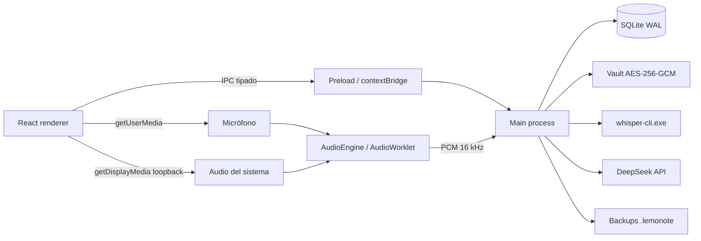

# Arquitectura

LemoNotes es una app Electron con tres procesos y una base de datos local. La regla principal es que **el renderer nunca recibe la clave de cifrado ni la API key**.

## Procesos

### Main

`src/main/` contiene la ventana, el ciclo de vida, los handlers IPC y los servicios:

- `index.ts`: arranque, ventana, bandeja, permisos, `setDisplayMediaRequestHandler`, IPC.
- `db.ts`: SQLite con `node:sqlite`, migraciones, ajustes, sesiones, notas y búsqueda.
- `vault.ts`: clave de 32 bytes, AES-256-GCM, formato `.lemonaudio`, `safeStorage`.
- `audio-store.ts`: escritura por bloques del audio cifrado.
- `whisper.ts`: ejecuta `whisper-cli.exe` con WAV PCM 16 kHz mono.
- `ai.ts`: cliente DeepSeek, validación y normalización del JSON del acta.
- `backup.ts`: copia `.lemonote` cifrada y Markdown legible, con cola y reintentos.
- `export-session.ts` y `export-format.ts`: Markdown, texto y JSON.

### Preload

`src/preload/index.ts` expone una API tipada con `contextBridge`. El renderer no tiene acceso a `require`, `fs`, `child_process` ni a la clave.

### Renderer

`src/renderer/` es React 19 + CSS propio. Las pantallas principales son Inicio, Mis notas, Captura, Ajustes y Detalle de nota. Las tipografías Baloo 2 y Lora se sirven localmente desde Fontsource.

## Audio

- **Micrófono:** `navigator.mediaDevices.getUserMedia` con cancelación de eco, supresión de ruido y ganancia automática.
- **Sistema:** `navigator.mediaDevices.getDisplayMedia({ audio: true, video: false })`. El handler del main devuelve una pantalla y `audio: 'loopback'`. No se graba vídeo.
- **Fallback:** si el equipo rechaza la captura solo de audio, se intenta `video + audio`. Si el vídeo falla con `NotReadableError`, se conserva el micrófono y se avisa.
- **Mezcla:** Web Audio API + `AudioWorklet` convierten a PCM entero de 16 bits y 16 kHz. El main recibe bloques por IPC y los escribe en el almacén cifrado.
- **Dispositivo del sistema:** Windows entrega el audio del **dispositivo de salida predeterminado**, no “todo el equipo”. Si la reunión suena en otro dispositivo, hay que cambiarlo antes de grabar.

## Persistencia y cifrado

- SQLite con `journal_mode=WAL` y `synchronous=FULL`.
- Textos y metadatos cifrados con **AES-256-GCM** a nivel de aplicación.
- La clave de 32 bytes se guarda cifrada con `safeStorage` (DPAPI en Windows).
- El audio final usa `.lemonaudio`: cabecera mágica + bloques AES-256-GCM.
- Durante la grabación se escribe un WAV temporal; al parar se cifra y se borra.
- La reproducción descifra a una caché temporal que se limpia al arrancar y al cerrar.

## Whisper

`whisper-cli.exe` se ejecuta como proceso hijo con un WAV PCM 16 kHz mono. El modelo por defecto es `ggml-base.bin` multilingüe. La cola es secuencial para no competir por CPU. Las grabaciones cortas se retranscriben completas al terminar; las largas conservan la transcripción incremental por bloques.

## DeepSeek / Limo

El main lee `DEEPSEEK_API_KEY` de `.env` y llama a la API por HTTPS. El renderer nunca ve la clave. La respuesta del acta se valida y se normaliza antes de guardarla. Sin clave, la app sigue funcionando y ofrece un borrador local sin IA.

## Copias

`backup.ts` genera:

- un `.lemonote` cifrado con la clave local;
- un Markdown legible en `backups/actas-legibles`.

Las copias son locales. No hay servidor remoto ni cuenta.

## Seguridad y límites

- El renderer está aislado (`contextIsolation`, sin Node) y solo carga código local.
- El lanzador usa `--no-sandbox` por compatibilidad con antivirus que inyectan hooks en Chromium. Es un compromiso de compatibilidad, no una recomendación general; el aislamiento del renderer y el modelo de permisos se mantienen.
- La app está pensada para Windows; el loopback depende de Windows/Chromium.
- No hay diarización automática: Whisper etiqueta “Hablante 1” y el nombre se corrige a mano.
- El ejecutable no está firmado.
